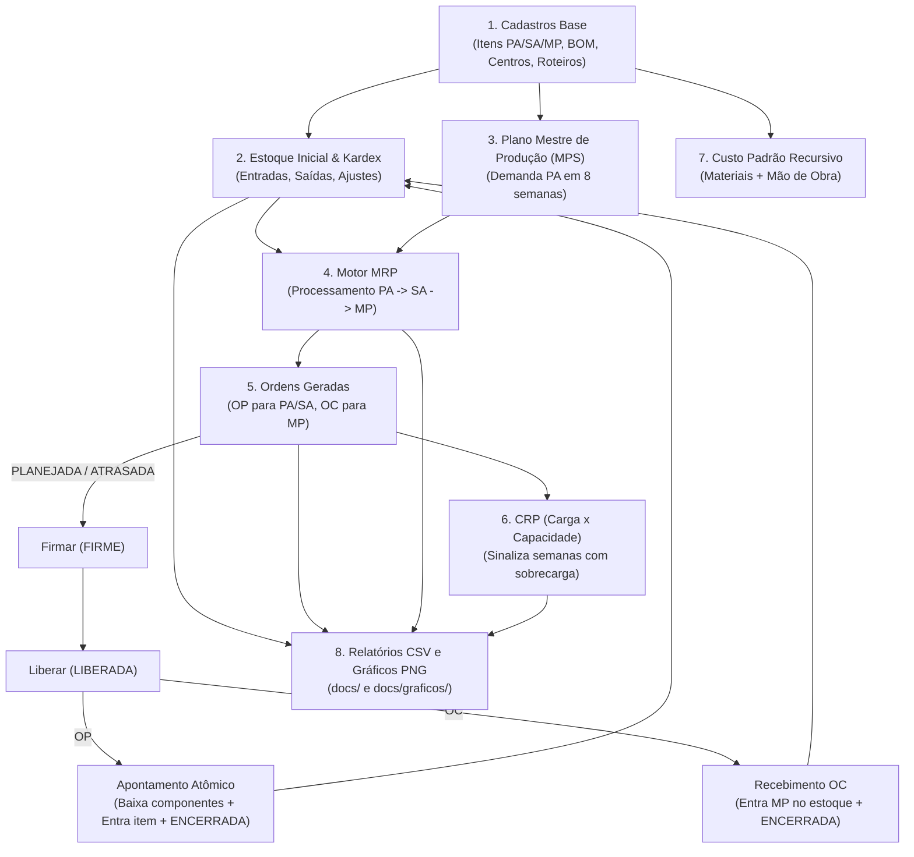

# Sistema MRP II — Pedal Forte Bicicletas

> Sistema de Planejamento dos Recursos de Manufatura (**MRP II**) em modo texto para a fábrica fictícia **Pedal Forte Bicicletas Ltda.** (Divinópolis-MG), integrando MPS, BOM multinível, gestão de estoques e kardex, cálculo MRP, ordens de produção e compra, apontamento, CRP, custo padrão, exportação CSV e gráficos gerenciais.


-informational.svg)

---

## Ficha Técnica e Contexto Acadêmico

| Campo | Informação |
|---|---|
| **Instituição** | CEFET-MG — Campus Divinópolis |
| **Curso / Disciplina** | Engenharia de Computação — Programação em Python |
| **Professor (Product Owner / Revisor)** | Guido Pantuza |
| **Responsável Técnico** | Kairo Henrique ([@KairoHenrique](https://github.com/KairoHenrique)) — Projeto Individual |
| **Cliente Fictício** | Pedal Forte Bicicletas Ltda. (GPTech Sistemas) |
| **Prazo de Entrega** | 23/11/2026 (SIGAA + Repositório GitHub) |
| **Stack Definida** | Python 3.10+, persistência JSON/CSV, relatórios gráficos com `matplotlib` |

---

## Visão Geral e Fluxo do MRP II

O sistema amplia o MRP clássico ao conectar o planejamento de materiais à verificação de capacidade dos centros de trabalho e ao custeio padrão dos produtos fabricados, respondendo a cada ciclo: **o que produzir ou comprar, quanto, quando e se há capacidade produtiva para atender ao plano**.



---

## Mapeamento de Requisitos e Regras de Negócio

### Requisitos Funcionais (RF)

| ID | Requisito | Módulo / Implementação |
|---|---|---|
| **RF01** | Exibir menu principal com opções do sistema | [`menu.py`](menu.py) (`exibir_menu_principal`, `executar_menu_principal`) |
| **RF02** | Cadastrar, listar e alterar itens (`PA`, `SA`, `MP`) | [`itens.py`](itens.py) (`cadastrar_item`, `listar_itens`, `alterar_item`) |
| **RF03** | Cadastrar BOM em até 3 níveis e exibir árvore indentada | [`estrutura.py`](estrutura.py) (`adicionar_componente`, `explodir_bom`, `exibir_arvore_bom`) |
| **RF04** | Registrar movimentações de estoque (`ENTRADA`, `SAIDA`, `AJUSTE`) | [`estoque.py`](estoque.py) (`registrar_movimentacao`) |
| **RF05** | Consultar saldo e kardex com alerta abaixo do estoque de segurança | [`estoque.py`](estoque.py) (`consultar_saldo_kardex`, `listar_posicoes_estoque`) |
| **RF06** | Cadastrar centros de trabalho e roteiros de operação única | [`capacidade.py`](capacidade.py) (`cadastrar_centro`, `cadastrar_roteiro`) |
| **RF07** | Cadastrar e alterar o MPS em horizonte de 8 semanas | [`mps.py`](mps.py) (`atualizar_mps`, `atualizar_semana_mps`, `exibir_mps`) |
| **RF08** | Executar cálculo MRP e exibir registro semanal de um item | [`mrp.py`](mrp.py) (`executar_mrp`, `exibir_registro_mrp`) |
| **RF09** | Gerar ordens planejadas (`OP` e `OC`) com semana de liberação e entrega | [`ordens.py`](ordens.py) (`gerar_ordem`) e [`mrp.py`](mrp.py) |
| **RF10** | Firmar, liberar e encerrar ordens controlando o ciclo de status | [`ordens.py`](ordens.py) (`firmar_ordem`, `liberar_ordem`, `encerrar_ordem_compra`) |
| **RF11** | Apontar produção de OP liberada pela quantidade total | [`ordens.py`](ordens.py) (`apontar_producao`) |
| **RF12** | Exibir carga × capacidade (CRP) por centro e sinalizar sobrecargas | [`capacidade.py`](capacidade.py) (`calcular_crp`, `exibir_crp`) |
| **RF13** | Calcular custo padrão dos itens fabricados percorrendo a BOM | [`custos.py`](custos.py) (`calcular_custo_padrao`, `exibir_custo_padrao`) |
| **RF14** | Exportar em CSV a posição de estoque e a lista de ordens | [`relatorios.py`](relatorios.py) (`exportar_estoque_csv`, `exportar_ordens_csv`) |
| **RF15** | Persistir todos os dados em `data/` e carregar automaticamente ao iniciar | [`persistencia.py`](persistencia.py) (`carregar_todos_dados`, `salvar_todos_dados`) |
| **RF16** | Gerar 4 gráficos com `matplotlib`, exibidos na tela e salvos em PNG | [`graficos.py`](graficos.py) (`grafico_posicao_estoque`, `grafico_estoque_projetado`, `grafico_ordens_por_semana`, `grafico_carga_capacidade`) |

### Requisitos Não Funcionais (RNF)

| ID | Critério | Atendimento no Projeto |
|---|---|---|
| **RNF01** | Projeto individual | Desenvolvimento integral pelo responsável técnico |
| **RNF02** | Python 3.10 ou superior | Compatível com Python 3.10+ (validado em Python 3.12) |
| **RNF03** | Aderência ao estilo PEP 8 | Verificado em todos os arquivos `.py` (indentação, nomenclatura e linhas $\le 79$ caracteres) |
| **RNF04** | Organização em módulos coesos | 14 módulos especializados conforme arquitetura da Seção 5 |
| **RNF05** | Tratamento de erros e entradas inválidas | Validações em [`utils.py`](utils.py) e tratamento de exceções em todas as interfaces |
| **RNF06** | Execução portável (Linux) | Uso exclusivo de `pathlib.Path` e `encoding="utf-8"` em leitura/gravação |
| **RNF07** | Persistência em JSON ou CSV | 7 arquivos JSON e 1 arquivo CSV (`movimentos.csv`) em `data/` |
| **RNF08** | Lógica implementada sem libs de ERP/MRP | Toda lógica de MRP, CRP, custos e estoque escrita em Python puro (`matplotlib` usado apenas em `graficos.py`) |
| **RNF09** | Base de demonstração mínima (`2 PA`, `2 SA`, `8 MP`, `2 CT`) | Base populada com **2 PA**, **3 SA**, **10 MP** e **3 CT** |

### Regras de Negócio (RN)

| Regra | Descrição e Validação |
|---|---|
| **RN01** | Código único no padrão `Tipo-Número` (`PA-001`, `SA-020`, `MP-201`) validado por regex em [`utils.py`](utils.py); apenas `PA` e `SA` possuem estrutura/roteiro. |
| **RN02** | Saldo de estoque nunca negativo; saídas ou ajustes que resultem em saldo $< 0$ são rejeitados em [`estoque.py`](estoque.py). |
| **RN03** | BOM limitada a 3 níveis (`PA` aceita `SA`/`MP`; `SA` aceita apenas `MP`; `MP` não tem estrutura), impedindo ciclos em [`estrutura.py`](estrutura.py). |
| **RN04** | MRP processado na ordem `PA` $\to$ `SA` $\to$ `MP`; necessidade bruta do componente soma as liberações dos pais multiplicadas pela quantidade por unidade. |
| **RN05** | Necessidade líquida na semana $t$: $NL(t) = \max(0,\; NB(t) + ES - (EP(t-1) + RP(t)))$. |
| **RN06** | Quando $NL(t) > 0$, o recebimento planejado é $\max(NL(t),\; \text{lote\_minimo})$. |
| **RN07** | Liberação planejada ocorre em $t_{\text{lib}} = t_{\text{entrega}} - \text{lead\_time}$; se $t_{\text{lib}} < 1$, a ordem recebe status `ATRASADA` e gera mensagem de exceção. |
| **RN08** | Apenas ordens `FIRME` ou `LIBERADA` entram como recebimentos programados ($RP$); ordens `PLANEJADA`/`ATRASADA` são recalculadas a cada execução do MRP. |
| **RN09** | Carga semanal do centro = $\sum (\text{quantidade da OP} \times \text{tempo unitário})$ das OPs na semana; há `SOBRECARGA` quando carga $>$ capacidade semanal. |
| **RN10** | Toda movimentação é registrada de forma imutável no kardex ([`data/movimentos.csv`](data/movimentos.csv)) com data e documento; correções são feitas via `AJUSTE`. |

---

## Estrutura do Repositório

```text
MRP2_PedalForte/
├── main.py                              # Ponto de entrada do sistema
├── menu.py                              # Menu principal e submenu de cadastros
├── itens.py                             # Cadastro, listagem e alteração de itens (RF02)
├── estrutura.py                         # BOM até 3 níveis e explosão recursiva (RF03)
├── estoque.py                           # Movimentações, saldo e kardex (RF04, RF05)
├── mps.py                               # Plano Mestre de Produção - 8 semanas (RF07)
├── mrp.py                               # Motor MRP por níveis (RF08, RF09)
├── ordens.py                            # Ciclo OP/OC e apontamento atômico (RF10, RF11)
├── capacidade.py                        # Centros de trabalho, roteiros e CRP (RF06, RF12)
├── custos.py                            # Cálculo recursivo de custo padrão (RF13)
├── relatorios.py                        # Exportação CSV de estoque e ordens (RF14)
├── graficos.py                          # Gráficos gerenciais com matplotlib (RF16)
├── persistencia.py                      # Leitura e gravação em data/ (RF15)
├── utils.py                             # Validações de entrada e formatação (RNF05)
├── data/                                # Base de demonstração Pedal Forte (RNF09)
│   ├── itens.json
│   ├── estrutura.json
│   ├── estoque.json
│   ├── movimentos.csv
│   ├── centros.json
│   ├── roteiros.json
│   ├── mps.json
│   └── ordens.json
├── docs/                                # Saídas geradas pelo sistema
│   ├── posicao_estoque.csv              # Relatório CSV de posição de estoque
│   ├── ordens.csv                       # Relatório CSV de ordens de produção/compra
│   └── graficos/
│       ├── 01_posicao_estoque.png
│       ├── 02_estoque_projetado_SA-020.png
│       ├── 03_ordens_por_semana.png
│       └── 04_crp_CT-03.png
└── README.md
```

---

## Base de Dados de Demonstração (`data/`)

A pasta `data/` já vem populada com um cenário realista da **Pedal Forte Bicicletas Ltda.**:

| Categoria | Quantidade | Exemplos na Base |
|---|---|---|
| **Produtos Acabados (`PA`)** | 2 | `PA-001` Bicicleta Aro 29 MTB, `PA-002` Bicicleta Urbana Aro 26 |
| **Semiacabados (`SA`)** | 3 | `SA-010` Quadro aro 29 soldado, `SA-020` Roda aro 29 montada, `SA-030` Roda aro 26 montada |
| **Matérias-Primas (`MP`)** | 10 | `MP-100` Tubo aço carbono, `MP-101` Tinta epóxi, `MP-200` Aro 29, `MP-201` Raio inox, `MP-202` Pneu 29x2.20, entre outros |
| **Centros de Trabalho (`CT`)** | 3 | `CT-01` Solda e Pintura (28 h/sem), `CT-02` Montagem de Rodas (30 h/sem), `CT-03` Montagem final (16 h/sem) |
| **Cenários Pré-configurados** | — | `MP-202` com saldo `18 un` abaixo do estoque de segurança (`20 un`), custo padrão de `PA-001` em `R$ 792,60`, `OP-0002` pronta para apontamento, `OC-0001` pronta para recebimento e sobrecargas semanais detectáveis no `CT-03` |

---

## Instruções de Instalação e Execução

### 1. Pré-requisitos

- **Python 3.10+** instalado ([python.org](https://www.python.org/))
- Biblioteca **`matplotlib`** (necessária para os gráficos de gestão do `RF16`)

### 2. Ambiente Virtual (Recomendado) e Dependência

- **Linux / macOS:**
  ```bash
  python3 -m venv venv
  source venv/bin/activate
  pip install matplotlib
  ```
- **Windows (PowerShell):**
  ```powershell
  python -m venv venv
  .\venv\Scripts\Activate.ps1
  pip install matplotlib
  ```

### 3. Executar o Sistema

Na pasta raiz do projeto:

```bash
# Linux / macOS
python3 main.py

# Windows
python main.py
```

---

## Decisões de Projeto e Arquitetura

1. **Separação entre regra de negócio e interface de texto**: em cada módulo, as funções principais (`cadastrar_item`, `explodir_bom`, `registrar_movimentacao`, `executar_mrp`, `apontar_producao`, `calcular_crp`, `calcular_custo_padrao`) são independentes de `input()`/`print()`, enquanto as funções auxiliares `_fluxo_*` e `menu_*` tratam a interação com o usuário.
2. **Estruturas de dados em memória**: os cadastros principais utilizam dicionários indexados por código (`itens`, `estoque`, `centros`, `roteiros`, `mps`, `ordens`, `estrutura`) para acesso direto em $O(1)$, enquanto o kardex (`movimentos`) usa lista ordenada cronologicamente preservando o histórico completo (`RN10`).
3. **Recursividade aplicada ao domínio (`RF03` e `RF13`)**:
   - Em [`estrutura.py`](estrutura.py), `explodir_bom` e `_imprimir_filhos_recursivo` percorrem a árvore até 3 níveis acumulando os fatores de quantidade.
   - Em [`custos.py`](custos.py), `calcular_custo_padrao` calcula o custo acumulado de materiais percorrendo os filhos recursivamente (com conjunto `visitados` de proteção contra ciclos) e soma a mão de obra do roteiro (`tempo_unitario * custo_hora`).
4. **Propagação de demandas de ordens confirmadas no MRP**: além das `liberacoes_planejadas`, OPs com status `FIRME` ou `LIBERADA` (ainda não apontadas) também propagam demanda para seus componentes em `mrp.py`. Isso evita que matérias-primas deixem de ser planejadas ao firmar uma OP antes do apontamento físico.
5. **Atomicidade no apontamento de produção (`RF11`)**: `apontar_producao` valida todos os componentes da BOM antes de efetuar qualquer movimentação. Se faltar algum insumo, toda a operação é abortada com mensagem detalhada indicando o saldo necessário e o disponível.
6. **Portabilidade e persistência segura (`RNF06`, `RF15`)**: caminhos construídos via `pathlib.Path` relativo ao diretório do projeto, codificação `utf-8` explícita e salvamento automático nas operações de alteração e ao encerrar o programa (inclusive via `KeyboardInterrupt`).

---

## Instruções de Uso (Ciclo Completo de Demonstração)

Ao iniciar o sistema, o menu principal apresenta as 9 funcionalidades integradas:

```text
======================================================
  MRP II - PEDAL FORTE BICICLETAS
======================================================
1. Cadastros (itens, estrutura, centros, roteiros)
2. Estoque (movimentar, saldo, kardex)
3. Plano Mestre de Producao (MPS)
4. Executar MRP
5. Ordens de producao e de compra
6. Carga x capacidade (CRP)
7. Custo padrao dos produtos
8. Relatorios (exportar CSV)
9. Graficos de gestao (matplotlib)
0. Sair
------------------------------------------------------
```

### Roteiro sugerido de operação

1. **Consultar estrutura (`1` → `2` → `1`)**: informe `PA-001` para visualizar a árvore indentada em 3 níveis (`PA-001` → `SA-010`/`SA-020` → `MP-*`).
2. **Verificar estoque e kardex (`2` → `2`)**: informe `MP-202` para ver o histórico de movimentações e o alerta de saldo abaixo do estoque de segurança (`18 un < 20 un`).
3. **Ajustar demanda no MPS (`3`)**: consulte ou altere as 8 semanas de demanda de `PA-001` e `PA-002`.
4. **Executar o MRP (`4` → `1` e `4` → `2`)**: execute o cálculo completo e consulte o registro semanal de um item (ex.: `SA-020`) para conferir `NB`, `RP`, `EP`, `NL`, `Receb. planejados` e `Liberação planejada`.
5. **Gerenciar ordens (`5`)**:
   - Use **`F`** para firmar uma ordem `PLANEJADA`/`ATRASADA` → `FIRME`.
   - Use **`L`** para liberar uma ordem `FIRME` → `LIBERADA`.
   - Use **`A`** para apontar uma OP `LIBERADA` (ex.: `OP-0002`), baixando automaticamente `MP-100` e `MP-101`, dando entrada em `SA-010` e encerrando a ordem.
   - Use **`E`** para receber e encerrar uma OC `LIBERADA` (ex.: `OC-0001`).
6. **Analisar capacidade (`6`)**: confira a carga semanal por centro de trabalho e as semanas marcadas como `SOBRECARGA` (ex.: `CT-03`).
7. **Consultar custo padrão (`7`)**: detalhe `PA-001` para visualizar materiais, mão de obra (`CT-03`) e o total (`R$ 792,60`).
8. **Exportar CSVs (`8`) e gerar gráficos (`9`)**: salve [`docs/posicao_estoque.csv`](docs/posicao_estoque.csv), [`docs/ordens.csv`](docs/ordens.csv) e os 4 arquivos PNG em `docs/graficos/`.
